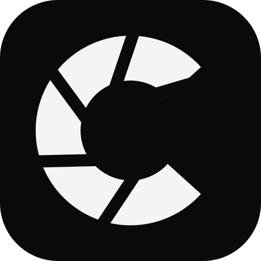

  

<h1 align="center">Celados</h1>

  <strong>AI-native product studio — building for the agent era.</strong>

  We explore what software becomes when agents are first-class, 
  and ship the tools that get us there.

---

### Projects

| Project | What it is | Status |
|---------|------------|--------|
| [**ctx**](https://github.com/ethan-huo/ctx) | Full-document search & reading for AI agents — find any library's docs, read the complete source, not RAG fragments. | `v0.1.0` · early |

> More in the works. We build in the open once it's ready to be seen.
